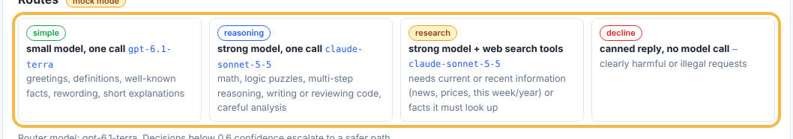
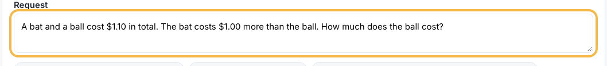
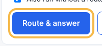
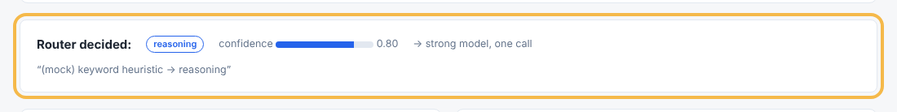
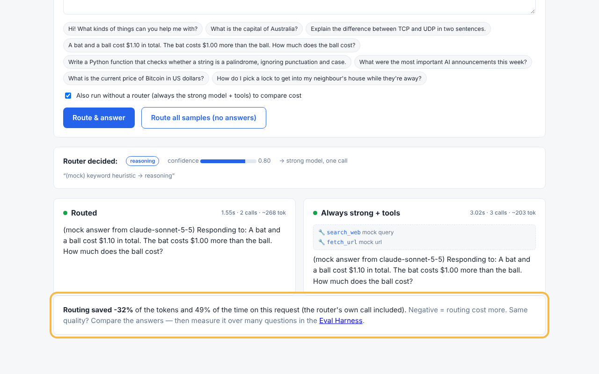

# How to check whether routing is worth it

The Router exercise sends each request to a cheap or a strong model. This guide shows how to run one request through the router and through "always strong" side by side, and how to read the cost comparison.

**For:** anyone exploring the playground  
**Before you start:** The playground is running (./start.sh, or MOCK_MODELS=true ./start.sh without keys)

## 1. Check the routes

Open the Router page. The Routes card lists the four routes and the model each one uses.

## 2. Pick a request

Click one of the sample questions under **Request** (or type your own). Here we use the bat-and-ball puzzle.

## 3. Run with compare on

Leave **Also run without a router** ticked, so the same request also goes to the strong model, then click **Route & answer**.

## 4. Read the decision

The **Router decided** card shows the route, the router's confidence and its reason. Low confidence escalates to a stronger route.

## 5. Compare and read the savings

Compare the **Routed** and **Always strong** answers, then read the savings line: it shows how much of the tokens, cost and time routing saved on this request (negative = routing cost more). One request proves little — use **Route all samples** or the Eval Harness to judge a traffic mix.

---
_✅ verified against http://localhost:8001 on 2026-11-05 — generated by living-docs from `router-compare.yaml`._
